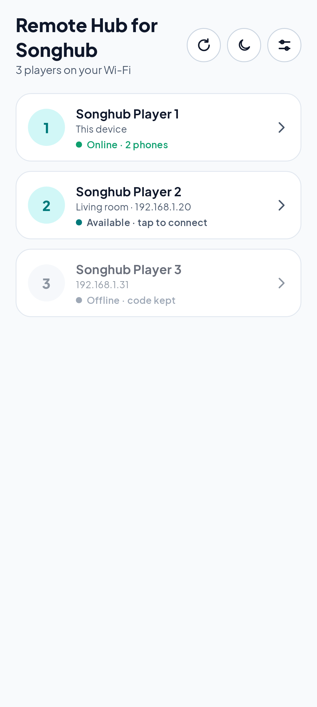
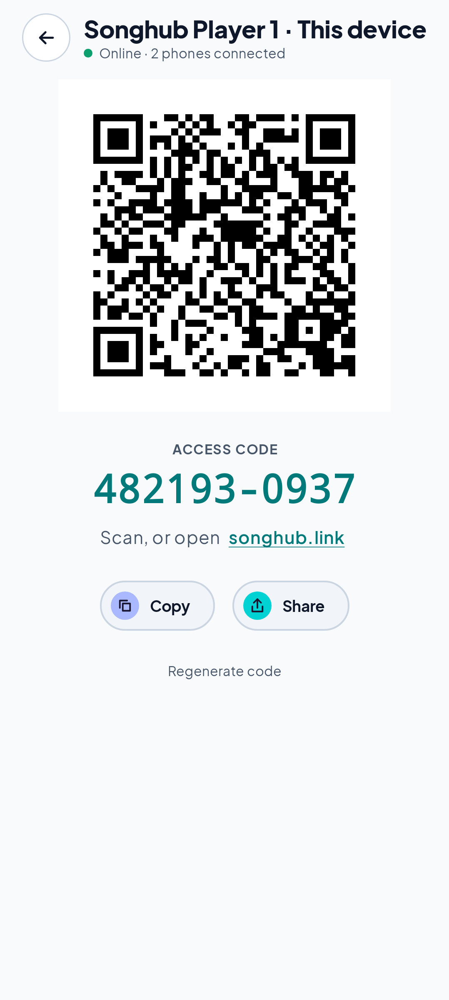
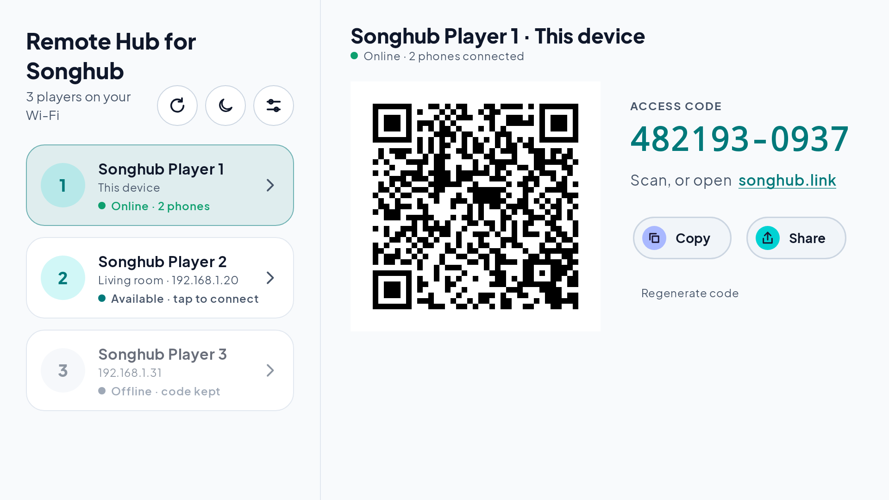

# RemoteHub for Songhub

**Control the official SongHub karaoke app from any phone, from anywhere, through [songhub.link](https://songhub.link). No modified APK needed.**

RemoteHub (full name *Remote Hub for Songhub*, formerly "Songhub Link App") runs on an Android device (TV, TV box, tablet or phone)
on the same Wi-Fi as your SongHub players. It finds every player on the network and gives **each player its own access code and QR**.

Current version: **v0.2.5** · [Download the latest release](https://github.com/jaybanaticla/songhub-link-app-releases/releases/latest)

| Phone | Android TV / large screen |
|---|---|
|   |  |

> **Upgrading from v0.1.0 – v0.1.4?** Those builds were signed with a different key, so Android can't update them in place.
> **Uninstall the old app once**, then install v0.2.5. (From v0.1.5 on, updates install normally.)

## Features

- **Finds your players automatically** (SongHub's broadcast, network service discovery and a quick Wi-Fi scan), plus manual IP entry.
  SongHub on the same device is listed first as **Songhub Player 1 · This device**.
- **Several players at once**: players are named **Songhub Player 1, 2, 3…**, and each keeps its own number, room and code on songhub.link.
- **Per-player access code + QR**, with **Copy**, **Share**, a songhub.link link that signs a phone straight in, and **Regenerate code**.
- **Resilient**: reconnects by itself after Wi-Fi changes, lost internet, a player closing or the device restarting. Offline players keep their code.
- **Runs in the background** ("Connected to N players" notification) and can **start on boot**.
- **Light and dark themes**, large tap targets, full **D-pad / Android TV** support.

## Requirements

- The official **SongHub** app with **Remote Broadcasting** turned on, on one or more Android devices.
- RemoteHub on an **Android 7.0+** device on the **same Wi-Fi** (it can be the same device as SongHub), with internet access.
- Phones just need a browser.

## How to use

1. **Install** `remotehub-v0.2.5.apk` from the [releases page](https://github.com/jaybanaticla/songhub-link-app-releases/releases/latest)
   (allow "install unknown apps" for your browser or file manager if asked).
2. On each player, open **SongHub**, turn on **Remote Broadcasting** and tap **Enter Karaoke**.
3. Open **RemoteHub**. It shows a radar while it looks for players, then lists them. Pull down (or press ⟳) to scan again.
4. **Tap a player** to see its access code and QR (on a TV, they appear to the right of the list).
5. On a phone, **scan the QR** or open **songhub.link** and enter the code. Use **Share** to send the code to friends.

The icons at the top switch the theme and open **Settings** (start on boot, run in the background, stop RemoteHub).

## Troubleshooting

| Problem | What to do |
|---|---|
| **No players found** | Open SongHub and tap **Enter Karaoke** (its remote server only runs on the player screen), turn on **Remote Broadcasting**, and keep both on the same Wi-Fi. Tap **Scan again** or **Enter IP manually**. |
| A player shows **Offline · code kept** | That SongHub player was closed or the device is off. Open it again; RemoteHub reconnects with the same code. |
| **Can't reach songhub.link** | The RemoteHub device has no internet. Tap **Reconnect** once it's back (it also retries by itself). |
| Guest / hotel / mesh "isolation" Wi-Fi | Client isolation blocks devices from talking to each other. Use a normal network, or run RemoteHub on the same device as SongHub. |
| It stops after a while | Open **Settings** and tap **Allow running in background**; on some brands also allow autostart. |
| **Too many attempts** | After 10 wrong codes the code entry locks for a while. Wait, then enter the correct code. |
| **App not installed** when updating | You have v0.1.0 – v0.1.4 (different signing key). Uninstall it once, then install the new APK. |

## Privacy & security

- Phones need the full access code (or a short-lived QR link) to connect; the relay stores only a hash of the code.
- Regenerating a code disconnects that player's phones and invalidates their sessions.
- The connection to songhub.link is encrypted (HTTPS/WSS). The local link to SongHub stays on your Wi-Fi and only private (LAN) addresses are accepted.
- RemoteHub keeps each player's room identity and code on the device (private app storage, excluded from backups).
  It collects no analytics or personal data. Songs, queue and controls pass through songhub.link only while phones are connected.

---

*RemoteHub and songhub.link are independent projects. They are not affiliated with, endorsed by or supported by the makers of SongHub.
"SongHub" is used only to describe compatibility.*
