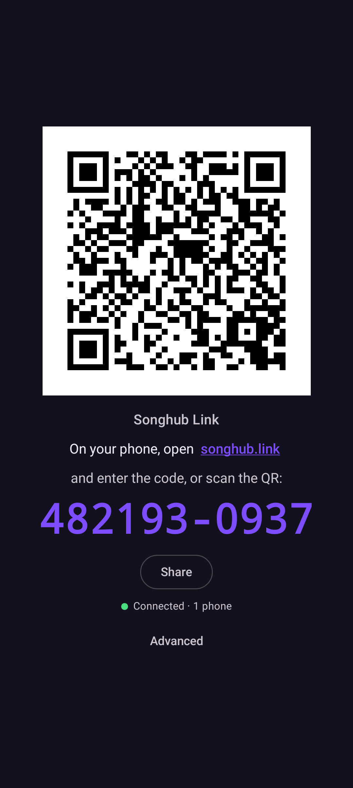
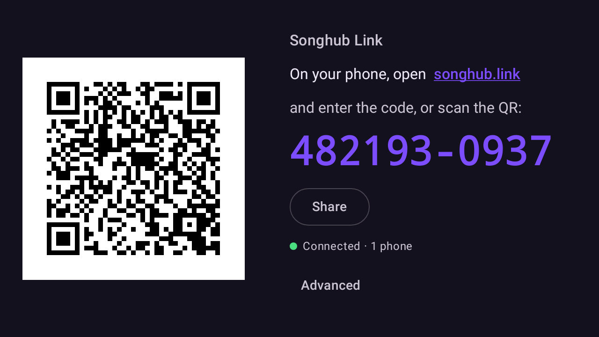
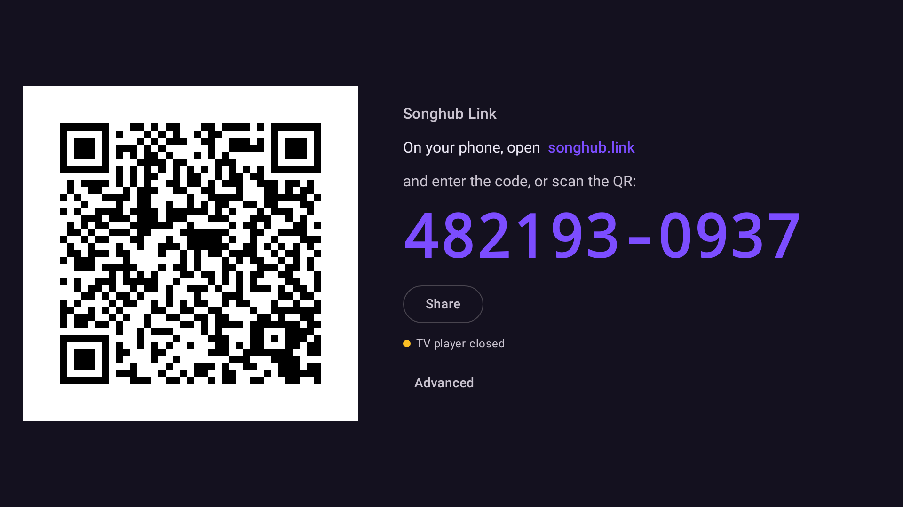

# Songhub Link App

**Use the official SongHub karaoke app with the [songhub.link](https://songhub.link) internet remote — no modded APK.**

Songhub Link App runs on your Android TV / box (or any Android device on the same Wi-Fi). It finds the
SongHub player on your network and connects it to songhub.link, so anyone with the access code can search,
reserve and control songs from any phone browser, from anywhere.

Current version: **v0.1.3** · [Releases / download](https://github.com/jaybanaticla/songhub-link-app-releases/releases)

| TV (1920×1080) | Phone portrait |
|---|---|
|  |  |
|  |  |

---

## Features

- **Auto-discovery** of the SongHub player on your Wi-Fi (SongHub's broadcast beacon, network service discovery,
  a quick network scan, and the last-used address), plus manual IP entry.
- **Internet remote from any browser**: phones open songhub.link — no remote app to install, no need to be on the TV's Wi-Fi.
- **Access code + large QR**: a 10-digit code (`123456-7890`) and a big, crisp QR that signs a phone in without typing.
- **Share** the code from the app; **Regenerate code** (Advanced) when you want to lock out everyone who had it.
- **Runs in the background** as a foreground service with a status notification; **start on boot** optional.
- **TV / D-pad support**: works with a remote control; side-by-side layout on TVs and landscape screens.
- **Basic and Advanced views**: the main screen shows only the code and QR; everything else is one tap away.
- **Song list cache**: the song list is kept in memory, so extra phones load it without asking the TV again.
- **Phone count**: see how many phones are connected (status line and notification).

## Requirements

- The **official SongHub** app on the TV with **Remote Broadcasting** turned on (this is what lets remotes connect over Wi-Fi).
- Songhub Link App on an Android device on the **same Wi-Fi** as SongHub (usually the same TV box).
- **Internet access** on that device.
- **Android 7.0 or newer**.

## How to use

1. **Install** the APK from the [releases page](https://github.com/jaybanaticla/songhub-link-app-releases/releases)
   (allow "install unknown apps" for your browser/file manager if asked).
2. **Open Songhub Link App.** The bridge starts by itself.
3. **Allow notifications** (Android 13+) so the background service can show its status, and tap
   **Allow running in background** in Advanced if your device asks about battery optimization.
4. **Open the SongHub player**: in SongHub, tap **Enter Karaoke**. (SongHub only accepts remotes while the player is open.)
5. **On your phone**, open **songhub.link** and enter the access code — or just **scan the QR** on the TV.
6. **Use the remote**: search and tap **Reserve**; Play / Stop / Next / Replay are up front, and
   **Advanced controls** has volume, key, tempo, vocal and more.
7. **Disconnect** a phone by tapping the **Connected** pill at the top of the remote.

## Advanced screen

Tap **Advanced** on the main screen (Back returns; the app remembers which view you used last).

- **Status**: SongHub player (LAN) and songhub.link relay, with details, phones connected and song list size.
- **Bridge**: **Start / Stop**, **Start on boot**, battery-optimization prompt.
- **Access code**: **Regenerate code** (changes the last 4 digits and disconnects connected phones).
- **SongHub on this network**: found devices (tap to use one), **Scan network**, and **manual IP** (e.g. `192.168.1.20`).
  If SongHub runs on the same device it is found at `127.0.0.1`.

## Troubleshooting

| What you see | What to do |
|---|---|
| Phone shows **"The karaoke player isn't open"** / app says **TV player closed** | Open SongHub on the TV and tap **Enter Karaoke**. The remote picks up automatically. |
| Phone shows **"Your TV isn't connected"** / **TV offline** | The TV is off, Songhub Link App isn't running, or the TV has no internet. Turn it on, open the app, check internet. |
| **SongHub not found** | Make sure the player is open and **Remote Broadcasting** is on, and both apps are on the same Wi-Fi. Use **Scan network** or enter the TV's IP in Advanced. |
| Found, but never links on **guest / hotel / mesh "isolation" Wi-Fi** | Client isolation blocks devices from talking to each other. Use a normal Wi-Fi network, or run Songhub Link App on the same box as SongHub (`127.0.0.1`). |
| Bridge stops after a while | Battery optimization killed it. In Advanced tap **Allow running in background**; on some brands also allow autostart / "no restrictions" in system settings. |
| **QR link expired** | QR links last a few minutes; the app shows a fresh QR automatically. Scan again or type the code. |
| **Too many attempts** | After **10 wrong codes** the code entry locks for a while (the remote shows a countdown). Wait, then enter the correct code. |

## Privacy & security

- Phones need the full access code (or a short-lived QR link) to connect; the relay stores only a hash of the code.
- Regenerating the code disconnects every phone and invalidates their sessions.
- The connection to songhub.link is encrypted (HTTPS/WSS). The local link to SongHub stays on your Wi-Fi and only
  private (LAN) addresses are accepted.
- The app keeps its room identity and code on the device (private app storage, excluded from backups). It does
  not collect analytics or personal data. Songs, queue and controls pass through songhub.link only while phones are connected.
